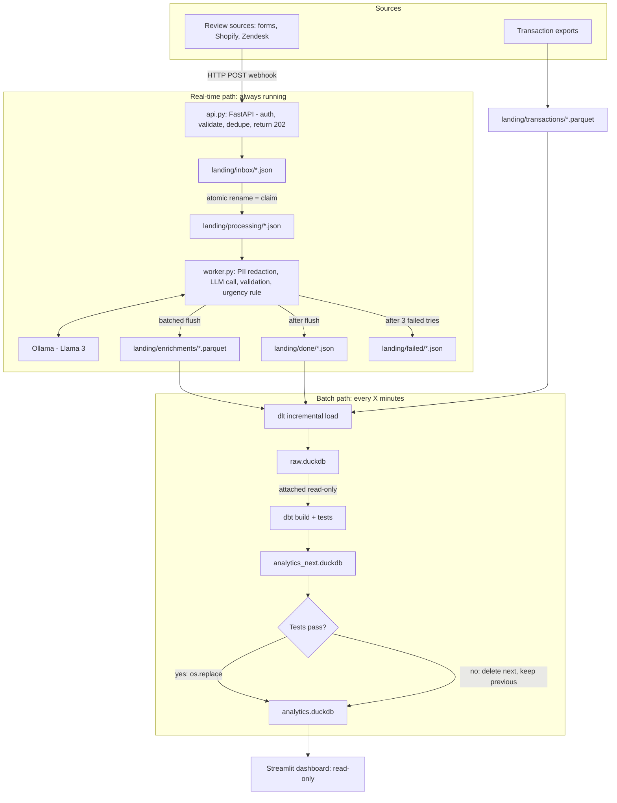

# Project Context: AI Review Triage (DuckDB + LLM)

Persistent context for AI assistants and for me. Update the "Decisions log" and "Progress" sections as the project evolves.

Source planning doc (diagrams + backlog): [Notion - Doc & planning](https://app.notion.com/p/40e1e068323c805d861ed4d10dad17a3)

## 1. Goal

Personal learning project to combine several tools in one realistic pipeline: FastAPI, Ollama (Llama 3), dlt, DuckDB, dbt, Streamlit.

**Business value:** businesses are flooded with reviews and support tickets. Sorting, tagging and analysing them by hand takes hours. This project automates the triage with a local LLM and gives the owner a near real-time dashboard of issues over time, linked to e-commerce transactional data.

## 2. Architecture



## 3. Stack

- **Ingestion API:** FastAPI + Pydantic
- **LLM:** Ollama, local Llama 3 (8B). Plain Python client, structured JSON output validated with Pydantic
- **Loading:** dlt -> `raw.duckdb`
- **Transform:** dbt-duckdb, medallion layers (staging -> intermediate -> marts) -> `analytics.duckdb`
- **Dashboard:** Streamlit, read-only on `analytics.duckdb`
- **Scheduler for batch path:** simple loop or cron (to decide)
- **Later:** LangChain for a RAG "Ask your reviews" chat

## 4. Data contracts

### Review payload (webhook input)

- `review_id` (stable, unique - also used as file name for dedupe)
- `source` (form, shopify, zendesk...)
- `order_id`, `client_id`, `product_id` (join keys to transactional data - required)
- `rating` (1-5)
- `text`
- `created_at`

### Enrichment output (worker)

- `review_id`
- `redacted_text` (kept for the future RAG feature)
- `category` (fixed list: delivery, quality, price, support, payment, other)
- `sentiment_score` (-1 to 1) and `sentiment_label`
- `key_issues` (list of short strings)
- `is_urgent` (bool)
- `model_name`, `processed_at`

### Transactional mock data (parquet)

`product`, `category`, `order_head`, `order_items`, `deliveries`, `payments`, `clients`. IDs must be consistent with the review payloads so reviews can be joined to orders.

## 5. Key design rules

- **API never calls the LLM.** It writes one JSON per review to `landing/inbox/` and returns 202.
- **Dedupe:** file named by `review_id`; existing file = duplicate.
- **Claiming:** worker moves `inbox/` -> `processing/` with an atomic rename. Prevents double processing; leftover files in `processing/` are recovered on restart.
- **Retries:** 3 failed tries -> `landing/failed/` (dead-letter).
- **Urgency is a deterministic Python rule**, not an LLM decision. Starting proposal: `rating <= 2 AND sentiment_score <= -0.6`, OR keywords like "refund", "lawyer", "never again". Tune later.
- **DuckDB single-writer:** only dlt writes to `raw.duckdb`; only the dbt build writes to `analytics_next.duckdb`; Streamlit only reads `analytics.duckdb`.

### Analytics swap

1. dbt builds into `analytics_next.duckdb` (reads `raw.duckdb` attached read-only).
2. dbt tests run on it.
3. Pass: close all connections, ensure no leftover `.wal` file, then `os.replace("analytics_next.duckdb", "analytics.duckdb")` (atomic on same disk).
4. Fail: delete `analytics_next.duckdb`; dashboard keeps the last good version.
5. Streamlit opens a fresh read-only connection per query (or short cache TTL) so it picks up the new file.

## 6. Decisions log

- 2026-11-05: **Notifications dropped.** `is_urgent` is stored and shown in the dashboard only, no Slack/email.
- 2026-11-05: **No LangChain in the pipeline.** Steps are fixed and few; plain Python + Ollama is simpler. Pipeline steps: PII redaction -> category + sentiment (structured output) -> validation -> urgency rule.
- 2026-11-05: **LangChain kept for a later RAG feature** ("Ask your reviews" chat in Streamlit, over redacted review text and/or SQL on `analytics.duckdb`).
- 2026-11-05: **Evals run offline**, against a small hand-labelled set (30-50 reviews), not inside the per-review pipeline.
- 2026-11-05: Dashboard is described as **near real-time** (refreshes every batch), not real-time.
- 2026-11-05: **Mock generators.** Python 3.12 + `uv`, Faker (`fr_FR`), pandas/pyarrow for parquet, httpx for the webhook. Review text comes from **templates** (not an LLM) so labels are known. Reviews are sent as a **continuous stream** (1 every N seconds).
  - Counts: 5 categories, 10 products, 50 clients, 100 orders, 1-3 lines per order. ~20% of deliveries are late.
  - Order statuses: delivered, returned, cancelled, shipped (in transit), processing. Payment statuses: paid, failed_then_paid, refunded.
  - Reviews only target delivered/returned orders. Late deliveries -> mostly negative delivery reviews; non-paid payments -> mostly payment reviews; returned orders -> mostly negative quality reviews.
  - Stream includes test cases: ~10% rating/text mismatch, ~10% PII (email/phone), ~5% duplicate `review_id`.
  - Ground truth labels go to `data/mock/reviews_ground_truth.jsonl` (never sent to the API). Webhook auth header: `X-API-Key` (default `dev-key`).
## 7. Progress

- [ ] Initial tool research (Ollama, FastAPI done; dlt, dbt-duckdb remaining)
- [x] Mock transactional data: product, category, order_head, order_items, deliveries, payments, clients (`make mock-transactions`)
- [x] Mock review generator (using real IDs from the mock data) (`make mock-reviews`, `make mock-reviews-dry`)
- [ ] FastAPI webhook: validation, dedupe, write to inbox
- [ ] worker.py: claim, PII redaction, LLM call, validation, urgency rule, flush, retries
- [ ] dlt incremental load -> raw.duckdb
- [ ] dbt project (staging, intermediate, marts + tests) -> analytics_next.duckdb + swap
- [ ] Streamlit dashboard
- [ ] Offline eval on labelled set
- [ ] One-command start (Makefile or docker-compose)
- [ ] Later: LangChain RAG chat

If time runs short, cut the swap step first and keep the full flow working end to end.

## 8. Open questions

- Batch scheduler: Python loop vs cron?
- Exact Llama model/size to use with Ollama (check speed on local machine).
- PII redaction approach: regex vs a library like Presidio.

## 9. Repo layout

```
generators/
  config.py            # counts, seed, paths, API url, test-case rates
  transactions.py      # -> landing/transactions/*.parquet
  review_templates.py  # templates per issue category x sentiment
  reviews.py           # stream to POST /webhook/reviews (--interval, --count, --seed, --dry-run)
Makefile               # mock-transactions, mock-reviews, mock-reviews-dry
```
